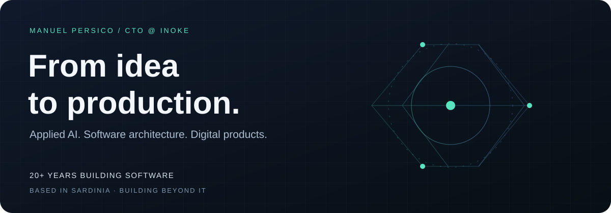

<p align="center">
  
</p>

<p align="center">
  <a href="https://inoke.studio">[ inoke.studio ]</a> &nbsp;
  <a href="https://www.linkedin.com/in/manuel-persico-bb8793b0/">[ linkedin ]</a> &nbsp;
  <a href="#-workbench">[ open-source workbench ]</a>
</p>

## `~ / about-me`

Computers have had my attention since I was a kid. I want to know what happens underneath: how the pieces communicate, why something fails, and what else it could do. That curiosity became my profession. The urge to tinker never went away.

I'm **Manuel Persico**, **CTO at Inoke since 2016**, with **20+ years across software engineering, systems administration and technical leadership**. I move between application code, databases, infrastructure and hardware interfaces. I like the problems that cross those boundaries — especially when solving them means learning how an unfamiliar system actually works.

**A builder's mindset, a hacker's curiosity, a white-hat ethic:** understand deeply, experiment responsibly, respect permission and privacy, and leave things better than I found them.

I can lead the technical direction and get my hands into the implementation. For **ACCERT and QuickBooking**, that has meant the full journey: idea, requirements, architecture, code, integrations and CI/CD.

## `~ / capabilities`

```text
+-------------------+-----------------------------------------+
| APPLIED AI        | LLM integrations, RAG, semantic search  |
|                   | Knowledge bases, prompts, evaluation    |
+-------------------+-----------------------------------------+
| PRODUCT BUILDING  | Architecture, full stack, APIs, data    |
|                   | From a rough idea to production         |
+-------------------+-----------------------------------------+
| SYSTEMS THINKING  | Cloud, Linux, Docker, CI/CD, SysOps     |
|                   | Debug across layers. Own the delivery.  |
+-------------------+-----------------------------------------+
| TINKERER MODE     | Hardware interfaces, protocols, tools   |
|                   | Understand it. Make it work. Share it.  |
+-------------------+-----------------------------------------+
```

My current focus is **AI that works with real knowledge and real users**. I build conversational assistants, integrate hosted models, experiment with local models and connect them to document collections through retrieval and vector search. I work with domain experts to review answers and sources.

AI coding agents are also part of my workbench: analysis, development, refactoring, documentation and testing — with engineering judgment and validation throughout.

## `~ / workbench`

### `> SignalRGB x EPOMAKER TH80 V2 PRO`

**[View the code →](https://github.com/manuel-84/signalrgb-epomaker-th80-v2-pro)**

A good example of my tinkering side: an unofficial **JavaScript plugin that connects a keyboard to SignalRGB over USB using its stock firmware**.

```text
[ SOFTWARE ] <---- USB / HID ----> [ HARDWARE ]
     |                                  |
     +-- 78-key RGB mapping             |
     +-- bounded transfers              |
     +-- lighting-effect restoration ---+
     +-- offline protocol tests

Firmware flashing: not required.
Curiosity: required.
```

## `~ / selected-work`

### `01 / AI meets cultural heritage`

- **GrazIA · ISRE / Museo Deledda** — Conversational assistant about Grazia Deledda. Knowledge preparation and integration with a museum digital installation.
- **Sisaia · Museo Archeologico Nazionale di Nuoro** — Conversational archaeology: technical design, knowledge-base architecture, and review of answers, chronology and sources with scientific staff.
- **e.INS · Territorial assistants** — Cultural and tourism AI for **Dorgali, Galtellì and Oliena**, and **GAL BMG — Racconti di Gusto**. Includes **digital libraries for Dorgali and Oliena**, connecting organized documents with accessible knowledge.

### `02 / Ideas turned into products`

- **ACCERT & QuickBooking** — End-to-end responsibility, from the initial idea and architecture to implementation and CI/CD.
- **BFlows / Memento** — Fintech frontend development, API integration, customer and invoicing workflows, maintenance and technical handover.
- **My Culture · 2023–June 2024** — Senior Software Engineer / CTO. Video-on-demand frontend, DevOps/SysOps, GitHub repositories, AWS Amplify and mobile delivery coordination.
- **Lìberos · 2012–2016** — Technical development of a cultural network platform with PHP, Yii, MySQL and Node.js.

### `03 / The foundations underneath`

Before Inoke: **UltraDigital founder**, independent development and consulting, and **Windows systems / SQL Server work at Sorint.LAB for BIt Systems, Borsa Italiana / LSEG**. My background also includes public-sector information systems, web platforms, e-commerce and immersive projects.

These are professional project highlights; their source code is not necessarily public.

## `~ / toolbox`

```text
ai.retrieval   Python / LlamaIndex / LangChain / OpenAI API
               FAISS / HNSWlib

app.build      JavaScript / Vue / Nuxt / Node.js
               PHP / Laravel / Java / HTML / CSS

data.store     PostgreSQL / MySQL / SQL Server
               MongoDB / SQLite

ops.ship       Git / GitHub / CI/CD / Docker / Linux
               AWS / Azure / NGINX / Apache

test.explore   Jest / Cypress / Unity / Unreal Engine
               Oculus Quest
```

<details>
<summary><b>More than the stack</b></summary>

I've taught e-commerce and mentored young people in vocational IT training. Explaining technology is part of understanding it — and helping someone discover what they can build is worth the time.

My work connects technical leadership with hands-on delivery: making architectural decisions, writing code, integrating systems and keeping the result running.

</details>

---

```text
$ cat philosophy.txt
Stay curious. Go deeper. Build something useful.
```

<p align="center"><a href="https://inoke.studio">[ Inoke ]</a> · <a href="https://www.linkedin.com/in/manuel-persico-bb8793b0/">[ Let's connect ]</a></p>
